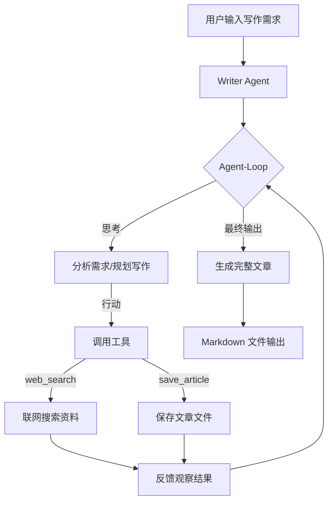

# AI 写作 Agent — 基于 LangChain 实现

## 一、项目简介

本项目基于 **LangChain** 框架搭建一个智能写作 Agent，能够根据用户的写作需求，自主完成**资料搜集 → 大纲生成 → 内容撰写 → 润色输出**的全流程写作任务。

### 核心特性

- 🤖 **智能写作**：基于大语言模型，理解用户写作意图
- 🔧 **工具调用**：支持联网搜索、文件保存等工具扩展
- 🔄 **Agent-Loop**：思考 → 行动 → 反馈的自主决策循环
- 📝 **结构化输出**：支持 Markdown、KaTeX 公式、Mermaid 图表
- 🧩 **可扩展**：模块化设计，方便添加新工具和写作策略

---

## 二、技术栈

| 组件 | 技术选型 | 说明 |
|------|---------|------|
| 大模型框架 | LangChain | LLM 应用开发框架 |
| Agent 框架 | LangChain Agents / LangGraph | Agent 编排与工具调用 |
| 大模型 | 阿里云通义千问 (qwen3.7-plus) | 通过 OpenAI 兼容接口调用 |
| 工具 | LangChain Tools | 自定义工具（搜索、保存等） |
| 日志 | Python logging | 运行日志记录 |
| 配置 | configparser | 配置文件管理 |

---

## 三、整体架构



### 架构说明

- **Writer Agent**：核心写作智能体，负责理解需求、规划写作、调用工具、生成内容
- **Agent-Loop**：思考（Thought）→ 行动（Action）→ 反馈（Observation）循环，直到生成最终结果
- **Tools**：可插拔的工具集，当前包含联网搜索和文件保存，可按需扩展

---

## 四、实现思路

### 4.1 Agent 设计

采用 LangChain 的 **Tool-Calling Agent** 模式：

1. **定义工具**：使用 `@tool` 装饰器注册写作相关工具
2. **构建 Prompt**：定义系统提示词，明确 Agent 角色和写作流程
3. **绑定 LLM**：将大模型与工具集绑定
4. **创建 AgentExecutor**：封装 Agent 执行循环

### 4.2 工具设计

| 工具名 | 功能 | 输入 | 输出 |
|--------|------|------|------|
| `web_search` | 联网搜索资料 | 搜索关键词 | 相关摘要信息 |
| `save_article` | 保存文章为文件 | 标题、内容、输出路径 | 文件保存路径 |

### 4.3 Prompt 工程

系统提示词包含：
- **角色定义**：专业写作助手
- **工具说明**：告知 Agent 可用工具及其用途
- **写作流程**：引导 Agent 按步骤完成写作
- **输出格式**：要求 Markdown 格式，支持公式和图表

### 4.4 输出格式规范

- **Markdown**：文章以 Markdown 格式输出
- **KaTeX 公式**：使用 `$...$` 表示内联公式，用 `$$...$$` 表示块级公式
- **Mermaid 图表**：使用 ` ```mermaid ` 代码块绘制流程图、时序图等
- **代码引用**：使用反引号 `` ` `` 包裹文件名或变量名
- **结构化输出**：使用标题、列表、表格等使输出清晰

### 4.5 输出管理

写作完成后，Agent 将结果保存为 Markdown 文件，并记录写作日志：

```
output/
├── 20260810_143022_文章标题.md   # 生成的文章
└── writing_log.json              # 写作日志（耗时、token 使用等）
```

---

## 五、核心代码实现

### 5.1 项目目录结构

```
ai-agent-writer-dev/
├── main.py                  # 入口文件
├── config.ini               # 配置文件
├── requirements.txt         # 依赖
├── core/
│   ├── agent_llm.py         # 自定义 LLM 封装
│   ├── logger.py            # 日志模块
│   ├── writer_agent.py      # 写作 Agent 核心
│   ├── tools.py             # 工具定义
│   └── prompts.py           # Prompt 模板
├── output/                  # 生成文章输出目录
└── log/                     # 运行日志
```

### 5.2 依赖安装

```bash
pip install langchain langchain-openai langgraph
```

`requirements.txt`:

```
langchain>=0.2.0
langchain-openai>=0.1.0
langgraph>=0.2.0
```

### 5.3 自定义 LLM 封装 (`core/agent_llm.py`)

```python
from langchain_openai import ChatOpenAI
from langchain_core.language_models import BaseChatModel

def get_llm(config) -> ChatOpenAI:
    """根据配置创建 LangChain LLM 实例"""
    llm = ChatOpenAI(
        model=config.get("model"),
        openai_api_key=config.get("api_key"),
        openai_api_base=config.get("base_url"),
        temperature=0.7,
        max_tokens=4096,
        timeout=60,
    )
    return llm
```

### 5.4 工具定义 (`core/tools.py`)

```python
from langchain_core.tools import tool
import requests
import json

@tool
def web_search(query: str) -> str:
    """联网搜索工具：根据关键词搜索相关信息，返回摘要。"""
    # 实际接入搜索 API（如 SerpAPI、Bing Search 等）
    # 这里用 mock 数据示意
    mock_results = {
        "LangChain Agent": "LangChain 是一个用于构建 LLM 应用的框架...",
        "AI 写作": "AI 写作工具正在快速发展，代表产品有...",
    }
    return mock_results.get(query, f"关于'{query}'的搜索结果：暂无相关信息")

@tool
def save_article(title: str, content: str, output_dir: str = "output") -> str:
    """保存文章工具：将生成的文章保存为 Markdown 文件。"""
    import os
    from datetime import datetime
    os.makedirs(output_dir, exist_ok=True)
    timestamp = datetime.now().strftime("%Y%m%d_%H%M%S")
    filename = f"{timestamp}_{title}.md"
    filepath = os.path.join(output_dir, filename)
    with open(filepath, "w", encoding="utf-8") as f:
        f.write(content)
    return f"文章已保存至: {filepath}"
```

### 5.5 Prompt 模板 (`core/prompts.py`)

```python
from langchain_core.prompts import ChatPromptTemplate, MessagesPlaceholder

WRITER_SYSTEM_PROMPT = """你是一个专业的写作助手 Agent，擅长帮助用户完成各类写作任务。

你可以使用以下工具：
- web_search: 联网搜索，获取写作所需的参考资料
- save_article: 将完成的文章保存为文件

写作流程：
1. 分析用户的写作需求（主题、风格、篇幅等）
2. 如需参考资料，使用 web_search 搜索相关信息
3. 根据需求和参考资料，撰写文章大纲
4. 按照大纲逐步完成文章写作
5. 对文章进行润色和优化
6. 使用 save_article 保存最终文章

写作要求：
- 内容准确、逻辑清晰
- 语言流畅、表达自然
- 适当使用 KaTeX 公式和 Mermaid 图表
- 输出格式为 Markdown
"""

def create_writer_prompt():
    return ChatPromptTemplate.from_messages([
        ("system", WRITER_SYSTEM_PROMPT),
        MessagesPlaceholder(variable_name="chat_history"),
        ("human", "{input}"),
        MessagesPlaceholder(variable_name="agent_scratchpad"),
    ])
```

### 5.6 写作 Agent 核心 (`core/writer_agent.py`)

```python
from langchain.agents import create_tool_calling_agent, AgentExecutor
from core.agent_llm import get_llm
from core.tools import web_search, save_article
from core.prompts import create_writer_prompt
from core.logger import logger

class WriterAgent:
    def __init__(self, config):
        self.llm = get_llm(config)
        self.tools = [web_search, save_article]
        self.prompt = create_writer_prompt()
        self.agent = create_tool_calling_agent(self.llm, self.tools, self.prompt)
        self.agent_executor = AgentExecutor(
            agent=self.agent,
            tools=self.tools,
            verbose=True,
            max_iterations=10,
            handle_parsing_errors=True,
        )

    def write(self, user_input: str, chat_history: list = None) -> str:
        """执行写作任务"""
        logger.info(f"收到写作任务: {user_input[:50]}...")
        result = self.agent_executor.invoke({
            "input": user_input,
            "chat_history": chat_history or [],
        })
        logger.info("写作任务完成")
        return result["output"]

    def chat(self, user_input: str, chat_history: list = None) -> dict:
        """交互式对话，返回完整结果"""
        result = self.write(user_input, chat_history)
        return {
            "output": result,
            "chat_history": chat_history or [],
        }
```

### 5.7 入口文件 (`main.py`)

```python
import os
import configparser
from core.writer_agent import WriterAgent

BASE_PATH = os.path.dirname(os.path.abspath(__file__))

def load_config():
    config = configparser.ConfigParser()
    config.read(os.path.join(BASE_PATH, "config.ini"), encoding="utf-8-sig")
    return config

def main():
    config = load_config()
    agent = WriterAgent(config["llm_api_aliyun"])

    print("=" * 50)
    print("  AI 写作 Agent")
    print("  输入 'quit' 退出")
    print("=" * 50)

    chat_history = []
    while True:
        user_input = input("\n📝 请输入写作需求: ").strip()
        if user_input.lower() in ("quit", "exit", "q"):
            print("再见！")
            break
        if not user_input:
            continue

        result = agent.chat(user_input, chat_history)
        print("\n" + "=" * 50)
        print(result["output"])
        print("=" * 50)

        chat_history.append(("user", user_input))
        chat_history.append(("assistant", result["output"]))

if __name__ == "__main__":
    main()
```

---

## 六、运行示例

### 6.1 启动 Agent

```bash
python main.py
```

### 6.2 交互示例

```
📝 请输入写作需求: 帮我写一篇关于 LangChain Agent 的技术博客，800字左右

> Entering Agent executor...
> Thought: 用户需要一篇关于 LangChain Agent 的技术博客，我先搜索一下相关资料。
> Action: web_search
> Action Input: {"query": "LangChain Agent 技术博客"}
> Observation: LangChain 是一个用于构建 LLM 应用的框架...
> Thought: 已获取参考资料，现在开始撰写文章。
> ...
> Final Answer: # LangChain Agent 技术博客
> ...

==================================================
# LangChain Agent 技术博客
（文章正文...）
==================================================
```

---

## 七、进阶优化方向

| 方向 | 说明 |
|------|------|
| **多 Agent 协作** | 使用 LangGraph 构建多 Agent 工作流，如大纲 Agent、写作 Agent、审校 Agent 分工协作 |
| **RAG 增强** | 接入向量数据库（如 FAISS、Chroma），构建本地知识库作为写作参考 |
| **流式输出** | 使用 LLM 的 streaming 能力，实现边生成边展示 |
| **多轮对话记忆** | 使用 `ConversationBufferMemory` 或 `ConversationSummaryMemory` 管理上下文 |
| **自定义工作流** | 用 LangGraph 定义状态机，精确控制写作流程的每个节点 |
| **评估与反馈** | 引入自动评估机制（如 LLM-as-Judge），对生成质量打分并迭代优化 |

---

## 八、参考资料

- [LangChain 官方文档](https://python.langchain.com/docs/get_started/introduction)
- [LangGraph 官方文档](https://langchain-ai.github.io/langgraph/)
- [LangChain Agent 教程](https://python.langchain.com/docs/modules/agents/)
- [Tool Calling 文档](https://python.langchain.com/docs/modules/model_io/chat/function_calling)

---

## 九、License

MIT License
